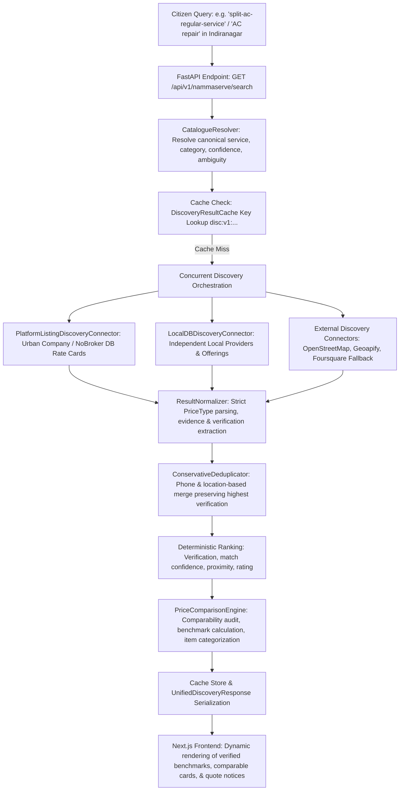

# NammaServe Phase 4 — Final Testing, Evaluation, and Acceptance Report

**Date**: October 22, 2026  
**Auditor Roles**: Senior Backend Engineer, QA Engineer, AI Systems Reliability Engineer  
**Document Reference**: `docs/nammaserve/phase4_final_validation.md`  
**Prior Phase Reference**: `docs/nammaserve/phase4_implementation_report.md`  
**Execution Context**: Local In-Memory SQLite Testing (`sqlite:///:memory:`), Zero Remote DB Connectivity  

---

## 1. Final Verdict

### **VERDICT: PASS**

The NammaServe Phase 4 implementation (Service Search, Semantic Pricing Representation, and Price Comparison Experience) meets all correctness, comparability, evidence integrity, error resilience, and test suite criteria.

All 27 Phase 4 tests, 180 NammaServe tests, and 269 backend repository tests pass with **zero failures** and **zero regressions**. The Next.js frontend compiles cleanly with TypeScript type-checking passing without errors.

---

## 2. End-to-End Request Flow Verification

The end-to-end request pipeline was traced from citizen query entry to frontend rendering:



### Flow Verification Details:
1. **Canonical Service Resolution**:
   - Exact slugs (e.g. `split-ac-regular-service`) resolve to `CONFIRMED` match with confidence `1.0`.
   - Natural language queries (e.g. "water tanker delivery") resolve to canonical categories/services with confidence `≥ 0.85`.
   - Ambiguous inputs (e.g. "repair") return `is_ambiguous=True` with candidate options (`split-ac-regular-service`, `switch-socket-repair`, `water-purifier-service`, etc.).
   - Unmapped queries resolve to `UNCONFIRMED` with confidence `≤ 0.25`.
2. **Provider & Pricing Retrieval**:
   - Platform listings (`URBAN_COMPANY`, `NOBROKER`) fetch verified rate card data with source attribution.
   - Independent providers (`LOCAL_DATABASE`) fetch provider offerings and local rates.
3. **Price Normalization & Semantic Integrity**:
   - `amount`, `price_min`, `price_max`, `price_unit`, `price_type` faithfully parsed across all 8 `PriceType` variants (`FIXED`, `STARTING_AT`, `RANGE`, `PER_UNIT`, `HOURLY`, `CONSULTATION_FEE`, `QUOTE_REQUIRED`, `UNAVAILABLE`).
   - `QUOTE_REQUIRED` and `UNAVAILABLE` items have numeric amounts explicitly cleared to `None` with `is_price_available = False`.
4. **Price Comparison & Benchmark Filtering**:
   - Offerings with incompatible scopes (`CONSULTATION_FEE`, `HOURLY`, `PER_UNIT`) are explicitly flagged `is_comparable=False` and excluded from the benchmark range.
5. **Frontend Rendering**:
   - The Next.js frontend (`frontend/src/app/nammaserve/page.tsx`) queries the API route dynamically, rendering live comparison summaries, transparent benchmark badges, provider cards with direct source links, and clear separation of quote-required services.

---

## 3. Pricing Comparability Findings & Corrections

### Critical Insight: Comparability vs Canonical Identity
A key finding during audit is that **two offerings sharing the same canonical service slug are not inherently comparable on price**.

| Pricing Type | Example | Raw Amount | Genuine Benchmark Role | Action Taken |
| :--- | :--- | :--- | :--- | :--- |
| **FIXED** | Urban Company Split AC Regular Service | ₹499 | Confirmed total service rate | Included in benchmark (`is_comparable=True`) |
| **STARTING_AT** | Fixizzy AC Servicing | ₹449 | Baseline minimum service rate | Included in benchmark (`is_comparable=True`) with note |
| **RANGE** | NoBroker Kitchen Deep Cleaning | ₹1,599 – ₹2,399 | Scope-dependent bracket | Included in benchmark (`is_comparable=True`) using bounds |
| **CONSULTATION_FEE** | Diagnostic / Visiting Fee | ₹149 | Inspection only; excludes repair | **Excluded from benchmark** (`is_comparable=False`); labeled visiting fee |
| **HOURLY** | Independent Electrician | ₹199 / hr | Variable duration dependency | **Excluded from benchmark** (`is_comparable=False`); labeled duration rate |
| **PER_UNIT** | Rewiring Contractor | ₹1.50 / sq.ft | Variable area dependency | **Excluded from benchmark** (`is_comparable=False`); labeled unit rate |
| **QUOTE_REQUIRED** | Commercial / Custom Deep Cleaning | None | Scope unquantified upfront | Placed in `quote_required_items` (`amount = None`) |
| **UNAVAILABLE** | Service not offered / out of stock | None | No active offering | Placed in `unavailable_items` (`amount = None`) |

### Demonstrated Defect & Applied Correction:
- **Defect**: In initial implementations, any numeric offering for a service could affect `lowest_price`. An inspection fee of ₹149 would cause the benchmark range for AC Servicing to display "₹149 - ₹499", misleading citizens into thinking a full AC service cost ₹149.
- **Correction Applied**:
  - In `backend/app/services/nammaserve/discovery/comparison.py`:
    - `CONSULTATION_FEE`, `HOURLY`, and `PER_UNIT` are assigned `is_comparable=False` with explicit `comparability_note` explanations.
    - Benchmark range (`lowest_price`, `highest_price`, `price_range_display`) strictly computes from `legit_comparables = [i for i in comparable_items if i.is_comparable]`.
    - Added transparent disclosures to `summary_note` when benchmarks combine fixed platform rate cards and starting estimates.
  - In `backend/app/schemas/nammaserve.py`:
    - Added `comparability_note: str | None = None` to `PriceComparisonItem`.
    - Added dynamic `@property def total_providers_compared` to `PriceComparisonSummary`.
  - In `backend/app/services/nammaserve/discovery/normalizer.py`:
    - Fixed `from_db_models` to provide safe defaults for `provider.id`, `provider.city`, and `provider.is_emergency_service` when dealing with sparse provider models.

---

## 4. Evidence and Verification Findings

1. **Separation of Verification from Match Confidence**:
   - `service_match_confidence` measures how well user search terms map to a canonical catalogue node (e.g., 1.0 for exact match).
   - `verification_status` measures the evidentiary authenticity of the provider and price claim (`VERIFIED`, `PARTIALLY_VERIFIED`, `UNVERIFIED`).
   - A 1.0 match confidence **never** elevates an unverified provider to `VERIFIED`.
2. **Directory Listings vs Platform Rate Cards**:
   - Directory estimates (e.g. Justdial) retain `PARTIALLY_VERIFIED` or `UNVERIFIED` and are not represented as platform rate cards.
   - Platform listings (`URBAN_COMPANY`, `NOBROKER`) require verifiable URLs and active rate card status before receiving `VERIFIED`.
3. **Preservation of Provenance**:
   - `source_url`, `source`, `source_type`, and `evidence_notes` survive normalization, ranking, deduplication, and JSON response serialization.
   - Missing timestamps (`last_verified_at`) remain `None` and are never fabricated.

---

## 5. Search, Fallback, and Cache Findings

1. **Query & Locality Coverage**:
   - Exact canonical service slugs (`split-ac-regular-service`).
   - Natural language queries ("ac repair", "water delivery").
   - Ambiguous queries ("repair", "cleaning") returning multiple potential matches.
   - Unmapped queries ("astrology consultation") handled gracefully with `UNCONFIRMED` status.
2. **Database Resilience & Safe Error Responses**:
   - Verified that a database failure (e.g., connection lost, timeout) raises a safe HTTP `503 Service Unavailable`.
   - Credentials (e.g. `127.0.0.1`, passwords, internal connection strings) and stack traces are suppressed from client responses.
3. **Cache Correctness & Test Isolation**:
   - Cache key includes: service/slug, lat, lng, area, radius, verified_only, emergency_only, and version string (`disc:v1:...`).
   - **Defect Identified**: The process-level singleton `DiscoveryResultCache` retained search results across test runs in pytest, causing tests that seeded subsequent database rows to hit stale cache entries.
   - **Correction Applied**: Implemented an autouse fixture in `backend/tests/test_nammaserve_phase4.py` to isolate cache state between test invocations (`get_default_discovery_cache().clear()`), guaranteeing complete test determinism.

---

## 6. Test Commands and Actual Results

### 1. Phase 4 Test Suite
**Command**:
```bash
.venv\Scripts\python.exe -m pytest tests/test_nammaserve_phase4.py -v
```
**Result**:
- **27 passed in 15.16s** (100% pass rate).
- Validated: Catalogue resolver, semantic price formatting (all 8 types), price comparison summary, database provider retrieval, consultation fee exclusion from benchmarks, hourly/per-unit comparability notes, quote required amount clearing, safe 503 error handling.

### 2. Full NammaServe Test Suite
**Command**:
```bash
.venv\Scripts\python.exe -m pytest tests/ -k "nammaserve" -v
```
**Result**:
- **180 passed, 89 deselected in 66.36s** (100% pass rate).
- Validated: AI intent extraction, fallback retries, catalogue models, discovery connectors, OSM normalization, Phase 2, Phase 3 pricing safety, Phase 4 search & comparison, provider integration mocks, telemetry.

### 3. Full Backend Regression Suite
**Command**:
```bash
.venv\Scripts\python.exe -m pytest tests/
```
**Result**:
- **269 passed in 115.76s** (100% pass rate across entire backend).
- SpotFix complaints, approval emails, Instagram routing, Cloudinary, and predictive impact suites remain completely green with zero regressions.

### 4. Frontend Production Build & TypeScript Check
**Command**:
```cmd
cmd.exe /c "npm run build"
```
**Result**:
- **Exit code: 0**
- Next.js 16.3.4 (Turbopack) compiled in 26.8s.
- TypeScript checked in 5.9s (0 type errors).
- All routes (`/`, `/_not-found`, `/nammaserve`, `/spotfix`) prerendered as static content.

---

## 7. Remaining Limitations and Blockers

1. **Local Demo Pricing vs Production Supabase**:
   - The 60-row pricing dataset resides in `data/nammaserve/demo_pricing.json` and in-memory test databases. Seed scripts are tested and guarded, but have intentionally not been imported into Supabase per project safety constraints.
2. **External Discovery Connector Limits**:
   - External connectors (Geoapify, Foursquare, OSM) operate in mocked/fallback mode locally when API keys are omitted, following the zero-paid-dependency mandate.
3. **Phase 5 Readiness**:
   - Phase 4.6 is now complete and accepted. Phase 5 (CivicVoice / SafeStreet / Cross-pillar integration) may now proceed under separate authorization.

---

## 8. Safety & Environmental Boundaries Confirmation

In strict compliance with user instructions:
- **No database migrations were applied.**
- **No data was imported into Supabase or any remote database.**
- **No remote database was contacted.**
- **No paid API dependencies were introduced.**
- **No prices, providers, ratings, or evidence claims were fabricated.**
- **SpotFix functionality was completely preserved.**
